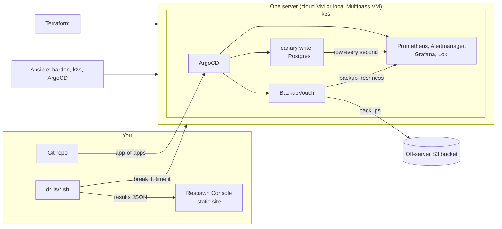

# Respawn

A small-team platform defined entirely in code, built to answer one question with numbers: **if the server dies at 2 a.m., how long until it is back, and how much data is gone?**

Most infra demo repos show that something deploys. Respawn is built to show that it **recovers**: scripts break it on purpose, time the recovery, and write the result to a JSON file that a static site renders.

> **Status: no real drill has been run yet.** Everything below is written and linted, and the drills have been exercised only against stand-in commands and in `--simulate` mode. The results table is empty until you run them. The repo does not contain a measured recovery time.

## Measured recovery (from `drills/results/`)

| Drill | What breaks | RTO (time to healthy) | RPO (data lost) | Status |
|---|---|---|---|---|
| `kill-node` | k3s service killed with SIGKILL | _pending_ | _pending_ | not yet run |
| `fill-disk` | Data disk filled to 97% | _pending_ | _pending_ | not yet run |
| `delete-server` | Whole VM destroyed, rebuilt from the repo | _pending_ | _pending_ | not yet run |

**Rule:** numbers go in this table only from result files with `"mode": "real"`. Simulated runs (`--simulate`) write `"mode": "simulated"` and `"label": "SIMULATED"`, and the console shows a permanent `SIMULATED DATA` banner for them. The three `drills/results/sample-*.json` files are simulated: they show what a result looks like and are not measurements.

How RTO and RPO are defined, and what each drill does, is in [docs/DRILLS.md](docs/DRILLS.md). In short: RTO is the time from the fault until a health check passes (API up, ArgoCD apps healthy, canary endpoint answering, canary sequence increasing). RPO is the number of canary rows lost, counted at one row per second.

## How it fits together



The backup bucket is deliberately **not** on the server: the `delete-server` drill destroys the server, and backups stored on it would go with it. Details and the full flow are in [docs/ARCHITECTURE.md](docs/ARCHITECTURE.md).

## What is inside

- **Terraform**: server, firewall and DNS (`infra/terraform`). Hetzner Cloud and Cloudflare are the providers written; DNS is optional.
- **Ansible**: OS hardening, k3s and ArgoCD install (`infra/ansible`).
- **ArgoCD on k3s**: Git is the source of truth (`gitops/`).
- **SOPS + age**: secrets committed encrypted (`gitops/secrets/`). Only a throwaway demo key exists; see the limits below.
- **Prometheus, Alertmanager, Grafana, Loki, Promtail**: with seven alert rules (plus one recording rule that maps BackupVouch's metric to a stable name), each alert with a promtool unit test (`alerts/tests/`).
- **BackupVouch**: scheduled backups and a restore-verified freshness signal.
- **Drills**: `kill-node`, `fill-disk`, `delete-server`, plus `run-all` and a one-shot `status` (`drills/`).
- **Respawn Console**: a static site that renders the results (`site/`).

## Try it

**1. See the console, no server, no cost.** This uses simulated data and says so on the page.

```
make drill-simulate          # runs all three drills with --simulate; nothing is written to the repo
make site-build              # needs Node 22; builds site/dist (shows the committed samples)
cd site && npm run preview
```

**2. Run the real drills on a free local VM** (Multipass; nothing billed). Follow [docs/RUNBOOK.md](docs/RUNBOOK.md) sections 0 and 2 for the order, with `make local-up` in place of `make apply`. You will need your own age key, an S3-compatible bucket that is not on the VM, and the BackupVouch wiring described in [docs/PROGRESS.md](docs/PROGRESS.md). Then:

```
make drill-all DRILL_ARGS="--host respawn-1 --via local --age-key keys.txt --yes-really"
make site-build
```

Every destructive drill needs `--host NAME` and `--yes-really`, waits ten seconds, and refuses an inventory host marked `respawn_protected: true`.

**3. On a paid cloud server** (Hetzner has no free tier): `make plan`, `make apply`, `make bootstrap`, then the same drills with `--via terraform`. `make apply` creates billed resources; `make plan` does not.

Run `make help` for every target.

## Known limits

- **One node.** A single-server k3s cluster has no failover: losing the server is an outage until it is rebuilt, which is exactly what `delete-server` measures. The `NodeDown` alert cannot report a whole-node loss, because Prometheus dies with the node.
- **RPO is bounded by the backup schedule.** Backups run hourly, so a full rebuild can lose up to about an hour of writes plus the backup duration. The drills measure the actual loss; they do not make it smaller.
- **Nothing has been measured.** The drills have not run against a real server or VM. Their real code paths were tested only against stand-in `kubectl`, `ssh`, `terraform` and similar commands, so several assumptions about a live cluster are unverified. They are listed in [docs/PROGRESS.md](docs/PROGRESS.md) under "Open issues".
- **`fill-disk` fills to 97%, not 100%.** Postgres normally keeps writing, so its RTO is mostly the time until the `DiskCritical` alert fires. The result notes say so.
- **The committed secret cannot be decrypted by you.** It was encrypted with a throwaway key that is not in the repo. Generate your own key and re-encrypt before use ([docs/RUNBOOK.md](docs/RUNBOOK.md) section 0). The Alertmanager webhook and Grafana admin secrets exist only as `*.example.yaml` files.
- **Placeholders remain.** The canary image `ghcr.io/souvik-biswas-dev/respawn-canary:0.1.0` is not built or pushed yet, and the backup bucket endpoint is `s3.example.invalid`. `restore-data` refuses to run until the endpoint is real.
- **Some pins are from memory** and unchecked against upstream: k3s, ArgoCD, the Prometheus and Loki chart versions, Postgres, and Hetzner's `server_type`. Check them before a real run.
- **Local VM differences.** `make local-up` has no cloud firewall or DNS, and its `delete-server` drill is `make local-destroy` plus `make local-up`.
- **Promtail is deprecated** upstream in favour of Grafana Alloy. It is used here because it is what the plan specified.

## Checks

CI ([.github/workflows/ci.yml](.github/workflows/ci.yml)) runs: `terraform fmt -check` and `validate`, tflint, ansible-lint and a playbook syntax check, kustomize plus kubeconform on the GitOps manifests, promtool rule check and unit tests, shellcheck on every script, gitleaks on the tree and the history, a simulated run of every drill with schema validation of all results, the console build, and a check that every file path mentioned in the docs exists. Actions are pinned to commit SHAs and downloaded tools to SHA-256 checksums. Locally, `make lint` runs everything except the console build. The workflow itself has not run on GitHub yet; what was run locally is recorded in [docs/PROGRESS.md](docs/PROGRESS.md).

## Docs

[docs/PRD.md](docs/PRD.md) (goal, scope, non-goals) · [docs/ARCHITECTURE.md](docs/ARCHITECTURE.md) · [docs/DRILLS.md](docs/DRILLS.md) (RTO/RPO definitions, result format) · [docs/RUNBOOK.md](docs/RUNBOOK.md) (the 2 a.m. commands) · [docs/DESIGN.md](docs/DESIGN.md) (console design) · [docs/PLAN.md](docs/PLAN.md) · [docs/PROGRESS.md](docs/PROGRESS.md) (what is done, what is unverified) · [CLAUDE.md](CLAUDE.md) (project rules)
